# CentyllionExtend — Structure du programme

Ce document décrit la structure interne du projet **CentyllionExtend** (extension de `centyllion-app`, projet de simulation multi-agents NetBioDyn). Il est organisé pour distinguer clairement :

- Les ** Parties Métier / Modélisation** (noyau de calcul, logique, données)
- Les ** Parties UI / Interface** (composants Jetpack Compose, interactions utilisateur)
- Les ** Fichiers de support** (traduction, utilitaires, tests)

### Nouveautés de l'extension

| Fonctionnalité | Description |
|---|---|
| **Génération spontanée** | `Behaviour.mainReactiveId = -1` : un comportement peut créer un agent sur une case vide (`None → Agent`). |
| **Compteurs de voisins** | `Behaviour.agentCountPredicates` : conditions structurées sur le nombre de voisins (`Agent_B > 3`). |
| **Expressions de condition** | `Behaviour.conditionExpression` : expressions booléennes avec parenthèses et opérateurs logiques (`count(1) > 2 && count(2) == 1`). |

Voir le [README.md](README.md) pour l'installation et l'exécution.

---

## 1. Vue d'ensemble de l'architecture

### 1.1 Architecture en couches

```
┌─────────────────────────────────────────────┐
│  UI / Interface (Compose)                   │
│  - AppState, Toolbar, tabs, plotter, rows   │
│  - Gestion de l'état, undo/redo, logs       │
└──────────────────────┬──────────────────────┘
                       │
┌──────────────────────┼──────────────────────┐
│  Composants de vue  │  Cœur métier          │
│  (ModelTab, etc.)   │  (centyllion/model)   │
│                     │  - Grain, Field,      │
│                     │    Behaviour, etc.    │
└──────────────────────┼──────────────────────┘
                       │
┌──────────────────────┼──────────────────────┐
│  Validation,        │  Évaluation,          │
│  Simulation,        │  Traduction,          │
│  I18n, utils        │  IA (Kotlin Symbol)   │
└──────────────────────┴──────────────────────┘
```

- Le **cœur** (`core/`) contient la logique métier pure, indépendante d'UI et de platforme.
- Le **front-end** (composants Compose) utilise ce cœur.
- Les deux modules partagent un code commun via des `expect/actual` Kotlin Multiplatform si nécessaire, mais ne sont pas mélangés.

---

## 2. Structure des packages (core)

```
core/src/commonMain/kotlin/com/centyllion/
├── expression/     ← analyseur, parser, évaluateur
│   ├── Ast.kt
│   ├── Builder.kt
│   ├── Check.kt
│   ├── Evaluation.kt
│   ├── Expression.kt
│   ├── Input.kt
│   ├── Lexer.kt
│   ├── Parser.kt
│   └── Stdlib.kt
├── i18n/           ← traductions
│   └── Locales.kt
└── model/          ← modèle de données du domaine
    ├── model.kt
    ├── simulator.kt
    ├── colors.kt
    ├── evaluator.kt
    ├── icons.kt
    ├── validation.kt
    ├── technic.kt
    ├── tools.kt
    └── utils.kt
```

---

## 3. Modèle métier (cœur dédié)

### 3.1 `com.centyllion.model.*`

#### 3.1.1 `Direction`

- **Rôle** : énumération des directions de déplacement dans la grille 2D/3D.
- **Variables membres** : les éléments de l'énumération (`Left, Right, Up, Down, LeftUp, RightUp, LeftDown, RightDown`).
- **Fonctions membres** :
  - `val deltaX` : déplacement horizontal (-1, 0, 1)
  - `val deltaY` : déplacement vertical (-1, 0, 1)
  - `val opposite` : direction opposée
- **Usage** : utilisé partout où un agent peut se déplacer (grains, champs, réactions).
- **Habitudes** : `Direction.default` = {Left, Up, Right, Down}, `extended` = {LeftUp, LeftDown, RightUp, RightDown}

#### 3.1.2 `Predicate<C : Comparable<C>>`

- **Rôle** : prédicat de comparaison (utilisé pour les conditions d'âge et de champs).
- **Variables membres** :
  - `op: Operator`
  - `constant: C`
- **Fonctions membres** :
  - `check(value: C): Boolean` — applique l'opérateur à la valeur.

#### 3.1.3 `Operator`

- **Rôle** : opérateurs de comparaison.
- **Variables membres** : `label: String`
- **Valeurs** : `Equals, NotEquals, LessThan, LessThanOrEquals, GreaterThan, GreaterThanOrEquals`

#### 3.1.4 `Asset3d`

- **Rôle** : définition d'un actif 3D pour l'environnement (utile pour la visualisation 3D).
- **Variables membres** : `url, opacity, x, y, z, xScale, yScale, zScale, xRotation, yRotation, zRotation`

#### 3.1.5 `ModelElement` (interface)

- **Rôle** : interface commune à tous les éléments du modèle.
- **Variables membres** :
  - `uuid: Uuid`
  - `name: String`
  - `description: String`

#### 3.1.6 `Field`

- **Rôle** : champ (couche de diffusion / dégradation) dans la simulation.
- **Variables membres** :
  - `id: Int`
  - `name: String`
  - `color: String`
  - `invisible: Boolean`
  - `description: String`
  - `speed: Float`
  - `halfLife: Int`
  - `allowedDirection: Set<Direction>`
  - `formula: String`
  - `uuid: Uuid` (transitoire)
- **Fonctions membres** :
  - `label(long: Boolean = false)` : label court/long
  - `deathProbability` (transitoire) : formule `1 - 2^(-1/halfLife)`
  - `oppositeDirections` (transitoire) : directions opposées à `allowedDirection`
- **Usage** : champ diffusif qui peut avoir une formule.

#### 3.1.7 `Grain`

- **Rôle** : grain (agent) de la simulation.
- **Variables membres** :
  - `id: Int`
  - `name: String`
  - `color: String`
  - `icon: String`
  - `invisible: Boolean`
  - `size: Double`
  - `description: String`
  - `halfLife: Int`
  - `movementProbability: Double`
  - `allowedDirection: Set<Direction>`
  - `fieldProductions: Map<Int, Float>`
  - `fieldInfluences: Map<Int, Float>`
  - `fieldPermeable: Map<Int, Float>`
  - `uuid: Uuid` (transitoire)
- **Fonctions membres** :
  - `label(long: Boolean = false)` : label court/long
  - `canMove` (transitoire) : peut-il bouger ?
  - `deathProbability` (transitoire) : probabilité de mort
  - `iconString` (transitoire) : nom de l'icône
  - `updateFieldProduction`, `updateFieldInfluence`, `updateFieldPermeable` : mises à jour immutables
  - `moveBehaviour()` : crée un `Behaviour` de déplacement si `canMove`
- **Usage** : les grains représentent les cellules ou agents.

#### 3.1.8 `Reaction`

- **Rôle** : réaction interne à un `Behaviour`.
- **Variables membres** :
  - `reactiveId: Int` (par défaut `-1`)
  - `productId: Int` (par défaut `-1`)
  - `sourceReactive: Int` (par défaut `-1`)
  - `allowedDirection: Set<Direction>` (par défaut `Direction.default`)
- **Usage** : décrit comment une réaction transforme un grain réactif en un autre.

#### 3.1.9 `Behaviour`

- **Rôle** : comportement (règles de transition) d'un grain.
- **Variables membres** :
  - `name: String`
  - `description: String`
  - `probability: Double`
  - `agePredicate: Predicate<Int>`
  - `fieldPredicates: List<Pair<Int, Predicate<Float>>>`
  - `agentCountPredicates: List<AgentCountPredicate>`
  - `conditionExpression: String`
  - `mainReactiveId: Int` (`-1` = case vide, pour la génération spontanée)
  - `mainProductId: Int`
  - `sourceReactive: Int`
  - `fieldInfluences: Map<Int, Float>`
  - `reaction: List<Reaction>`
  - `uuid: Uuid` (transitoire)
- **Fonctions membres** :
  - `reactiveGrainIds`, `productGrainIds`, `fieldInfluenced` (transitoires)
  - `reactionIndex`, `fieldPredicateIndex`, `agentCountPredicateIndex` : indexation interne
  - `updateReaction`, `dropReaction`, `updateFieldPredicate`, `dropFieldPredicate`
  - `updateAgentCountPredicate`, `dropAgentCountPredicate`
  - `updateFieldInfluence` : mise à jour
  - `applicable(grain: Grain?, age, fields, neighbours)` : vérifie si un comportement est applicable
  - `usedGrains(model)` : grains utilisés par ce comportement
- **Usage** : les comportements définissent les règles logiques (transition) des grains.

#### 3.1.9bis `AgentCountPredicate`

- **Rôle** : prédicat sur le nombre de voisins d'un type donné.
- **Variables membres** :
  - `grainId: Int` (type d'agent à compter)
  - `op: Operator` (`=`, `!=`, `<`, `<=`, `>`, `>=`)
  - `count: Int` (seuil)
- **Fonctions membres** :
  - `check(actualCount: Int): Boolean`
- **Usage** : conditions de comportement comme "nombre de Agent_B > 3".

#### 3.1.9ter Expressions de condition

- **Rôle** : conditions booléennes complexes sur un comportement.
- **Champ** : `Behaviour.conditionExpression: String`
- **Fonctions disponibles** : `count(grainId)`, `step`, `x`, `y`, `z`, fonctions mathématiques
- **Opérateurs** : `&&`, `||`, `!`, `==`, `!=`, `<`, `<=`, `>`, `>=`, parenthèses
- **Exemple** : `count(1) > 2 && (count(2) == 1 || count(3) == 0)`
- **Évaluation** : dans `Behaviour.applicable()` via `NetbioDynEvaluator(null)`

#### 3.1.10 `Position`

- **Rôle** : position 3D dans la grille.
- **Variables membres** : `x: Int, y: Int, z: Int = 0`
- **Fonctions membres** :
  - `move(direction: Direction, step: Int = 1)` : déplacement

#### 3.1.11 `GrainModel`

- **Rôle** : **modèle de simulation complet** (grains, comportements, champs).
- **Variables membres** :
  - `name, description` (hérités de `ModelElement`)
  - `grains: List<Grain>`
  - `behaviours: List<Behaviour>`
  - `fields: List<Field>`
  - `uuid: Uuid` (transitoire)
- **Fonctions membres** :
  - `label`, `findElement`, `grainForId`, `fieldForId`
  - `availableGrainName`, `availableGrainId`, `availableColor`
  - `newGrain`, `updateGrain`, `dropGrain`
  - `availableFieldId`, `availableFieldName`, `newField`, `updateField`, `dropField`
  - `availableBehaviourName`, `newBehaviour`, `behaviourIndex`, `updateBehaviour`, `dropBehaviour`
  - `doesGrainCountCanChange(grain)` : détermine si le nombre de grains peut changer
- **Usage** : le modèle de données principal.

#### 3.1.12 `SimulationSettings`

- **Rôle** : paramètres de configuration d'une simulation.
- **Variables membres** :
  - `size: Int`
  - `showGrid: Boolean`
  - `gridTextureUrl: String?`
  - `backgroundColor: String?`
- **Fonctions membres** (transitoires) :
  - `agentsSize = size * size`

#### 3.1.13 `Simulation`

- **Rôle** : simulation avec sa grille, ses agents et ses actifs 3D.
- **Variables membres** :
  - `name, description`
  - `settings: SimulationSettings`
  - `agents: List<Int>` (liste plate des identifiants d'agents)
  - `assets: List<Asset3d>`
  - `width, height, depth` (redondants avec les settings)
- **Fonctions membres** :
  - `label`
  - `levelSize, dataSize`
  - `moveIndex(index, direction, step)` : déplacement sur la grille
  - `toIndex(position)` / `toPosition(index)` : conversions
  - `indexInside`, `positionInside`
  - `assetIndex`, `updateAsset`, `dropAsset`
  - `valid` (propriété)
  - `cleaned(model)` : nettoie les références invalides
  - `updateSettings(newSettings)` : mise à jour
- **Usage** : l'état exécutable de la simulation.

#### 3.1.14 `ModelAndSimulation`

- **Rôle** : paire model + simulation (état complet de travail).
- **Variables membres** :
  - `model: GrainModel`
  - `simulation: Simulation`
  - `thumbnail: String`
- **Fonctions membres** :
  - `expert` (propriété) : déterminer si le mode expert est nécessaire
  - `updateInfo`, `updateModel`, `updateSimulation`
  - `updateGrain`, `addGrain`, `dropGrain`
  - `addField`, `updateField`, `dropField`
  - `addBehaviour`, `updateBehaviour`, `dropBehaviour`
- **Usage** : l'état de travail principal de l'application.

---

## 4. Cœur d'évaluation et d'expression

### 4.1 `com.centyllion.expression.*`

Ce package est un **moteur d'expression** (calculer des formules, prédicats, conditions) indépendant du modèle.

#### 4.1.1 `Value` (interface)

- **Rôle** : interface pour les valeurs d'expression (entiers, flottants, booléens).
- **Opérateurs** : `+`, `-`, `*`, `/`, `%`, `and`, `or`, `compareTo`, `not`, `pow`, `abs`
- **Propriétés** : `int`, `float`, `boolean`
- **Constantes** : `Zero`, `True`, `False`

#### 4.1.2 `IntegerValue`, `FloatValue`, `BooleanValue`

- **Rôle** : implémentations concrètes de `Value`.
- **Usage** : représentent des valeurs de types différents.

#### 4.1.3 `EvaluationException`

- **Rôle** : exception levée lors d'une erreur d'évaluation.

#### 4.1.4 `Evaluator`

- **Rôle** : moteur d'évaluation des expressions.
- **Variables membres** : `variables: Map<String, Value>`, `functions: Map<String, (List<Value>) -> Value>`
- **Fonctions membres** :
  - `check(node)` : vérifie les erreurs de référence
  - `function(name, args)` : appelle une fonction
  - `variable(name)` : récupère une variable
  - `evaluate(node)` : évalue une expression
- **Usage** : interprétage des formules et prédicats.

#### 4.1.5 `Ast.kt` — Arbre syntaxique abstrait (AST)

- **Rôle** : représentation des expressions arithmétiques et logiques.
- **Types** :
  - `Position` : position dans le source
  - `Severity` : sévérité
  - `ParsingException`, `ParsingError` : erreurs
  - `Node`, `SpaceAndCommentNode`, `TokenNode`, `IdentifierNode`, `LiteralNode` : noeuds de base
  - `TreeNode` : noeud intermédiaire avec enfants
  - `Expression` : interface pour les noeuds d'expression
  - `TernaryExpression`, `BinaryExpression`, `UnaryExpression`, `ExponentExpression`, `ParenthesisExpression`, `FunctionCall`, `VariableCall`, `BooleanLiteral`, `NumberLiteral`
- **Usage** : représentation intermédiaire pour analyse et évaluation.

#### 4.1.6 `Builder.kt` — Système de construction AST

- **Rôle** : faciliter la construction des noeuds d'expression avec syntaxe DSL.
- **Classes** :
  - `ModelProperty<T>`, `ModelOptional<T>` : propriétés lisibles/écribables
  - `BooleanLiteralBuilder`, `NumberLiteralBuilder`, `VariableCallBuilder`, `FunctionCallBuilder`, `ExponentExpressionBuilder`, `ParenthesisExpressionBuilder`, `UnaryExpressionBuilder`, `BinaryExpressionBuilder`, `TernaryExpressionBuilder`
- **Fonctions** : `buildNode()`, `property()`, `optional()`
- **Usage** : utilisé par le `Parser` pour construire l'AST.

#### 4.1.7 `Lexer.kt` — Analyseur lexical

- **Rôle** : analyse le texte en tokens.
- **Fonctions** :
  - `skipWhitespacesAndComments()`, `skipComments()`
  - `token(expected)`, `tokenWith(predicate)`
  - `peekToken`, `peekTokenWith`
- **Usage** : préparation des jetons pour le parser.

#### 4.1.8 `Parser.kt` — Analyseur syntaxique

- **Rôle** : transforme le flux de tokens en AST.
- **Fonctions** :
  - `readExpression()`, `readTerminal()`, `readUnary()`, `readExponent()`
  - `readSum()`, `readFactor()`, `readComparison()`, `readEquality()`, `readLogicAnd()`, `readLogicOr()`
  - `readIdentifier()`, `readToken()`, `readOneOfTokens()`, `literal()`, `finalNode()`
- **Usage** : analyse de la syntaxe des expressions.

#### 4.1.9 `Check.kt` — Vérificateur

- **Rôle** : vérifie la présence de variables et fonctions définies.
- **Classes** : `CheckVisitor`
- **Usage** : détection d'erreurs de référence dans les expressions.

#### 4.1.10 `Stdlib.kt` — Bibliothèque standard

- **Rôle** : registre des fonctions mathématiques et constantes.
- **Fonctions** :
  - `registerConstants()`, `defaultConstants()`
  - `registerFunctions()`, `defaultFunctions()`
- **Fonctions disponibles** : `abs, cos, sin, tan, acos, asin, atan, floor, ceil, round, min, max, ln, log, pi, e`
- **Usage** : être utilisé par le `Evaluator`.

---

## 5. Simulation (moteur d'exécution)

### 5.1 `simulator.kt`

- **Rôle** : moteur de simulation cellulaire (évolution de l'état).
- **Classes** :
  - `Agent` : agent avec `index`, `direction`, `reactiveId`, `age`, `fields`
  - `ApplicableBehavior` : comportement applicable à un agent
  - `Simulator` : simulateur principal
- **Variables membres de `Simulator`** :
  - `model: GrainModel`
  - `simulation: Simulation`
  - `random: Random`
  - `initialAgents: IntArray`, `agents: IntArray`, `ages: IntArray`
  - `currentAgents`, `fields`, `nextFields`
  - `grainCountHistory`, `fieldAmountHistory`
  - `step: Int`
  - `speeds`, `reactiveGrains`, `grainIdArray`
  - `fieldMaxId`
- **Fonctions membres** :
  - `oneStep()` : exécute une étape (retourne les comportements appliqués et les morts)
  - `reset()`, `resetCount()` : réinitialise la simulation
  - `oneStep()`, `resetCount()`, `reset()`, `resetIdAtIndex()`
  - `grainForId(id)`, `grainAtIndex(index)`
  - `transform(sourceIndex, targetIndex, newId, newAge)` : transforme un agent
  - `idAtIndex`, `ageAtIndex`, `ageGrain`, `fieldsAtIndex`, `setIdAtIndex`
  - `neighbours(index)` : donne tous les voisins
  - `grainsCounts()`, `fieldAmounts()`, `getSpeed()`, `setSpeed()`
  - `field(id)`, `fieldsAtIndex()`
  - `expressionEvaluator` et `evaluators` : moteurs d'évaluation
- **Variables statiques** : `minField`, `minFieldLevel`, `emptyFloatArray`

### 5.2 `evaluator.kt`

- **Rôle** : évaluateur de formules de champ.
- **Fonctions** :
  - `createEvaluator(simulator)` : crée l'évaluateur avec les variables de simulation
- **Usage** : évaluation des formules de champs pendant la simulation.

### 5.3 `colors.kt`

- **Rôle** : couleurs utilisées dans l'interface et le modèle.
- **Fonctions utilitaires** et constantes de couleur.

### 5.4 `validation.kt`

- **Rôle** : validation des modèles, messages d'erreur et diagnostics.
- **Usage** : vérification de la cohérence du modèle.

### 5.5 `technic.kt`, `tools.kt`, `utils.kt`

- **Rôle** : utilitaires techniques et outils de manipulation de modèles.
- **Usage** : fonctions de support réutilisables.

---

## 6. Partie UI (Interface utilisateur)

### 6.1 `com.centyllion.ui.*`

La couche UI est réalisée avec **Jetpack Compose** et Kotlin Multiplatform.

#### 6.1.1 `AppState`

- **Rôle** : état central de l'application.
- **Variables membres** :
  - `locale`, `logs`, `path`
  - `modelAndSimulation`, `model`, `simulation`
  - `expertMode`, `running`, `step`, `speed`
  - `simulator`, `grainCounts`, `fieldAmounts`
  - `past`, `future`, `canUndo`, `canRedo`
  - `selection`, `toolActive`, `tool`, `toolSize`
  - `problems`, `selectedProblem`
- **Fonctions membres** :
  - `newModel()`, `openPath()`, `setPath()`
  - `startSimulation()`, `step()`, `stopSimulation()`, `resetSimulation()`
  - `undo()`, `redo()`, `clearLogs()`
  - `emptyModel()`, `loadModel()`, `loadSimulation()`
- **Usage** : gestionnaire d'état de l'application, contient l'ensemble des données de l'interface.

#### 6.1.2 `AppContext`

- **Rôle** : interface décrivant le contexte de l'application pour les composants.
- **Fonctions membres** :
  - `locale`, `centerTabs`, `centerSelectedTab`, `eastTabs`, `eastSelectedTab`
  - `path`, `modelAndSimulation`, `model`, `simulation`
  - `expertMode`, `running`, `step`, `simulator`, `selection`
  - `problems`, `selectedProblem`, `logs`
  - `log()`, `warn()`, `alert()`, `showPrimarySelection()`

#### 6.1.3 `App`

- **Rôle** : racine du composant UI.
- **Structure** : `Column` contenant `ToolBar` et `MainView`.

#### 6.1.4 `MainView`

- **Rôle** : vue principale de l'application.
- **Structure** : `Row` contenant :
  - `ComponentTree` (gestionnaire de composants)
  - `Tabs` (onglets centraux : `ModelTab`, `SimulationTab`, `EnvironmentTab`)
  - `Tabs` (onglets est : `PlotterTab`, `LogsTab`)

#### 6.1.5 `Toolbar`

- **Rôle** : barre d'outils de l'application.
- **Usage** : contrôles d'interface (boutons démarrer, reculer, etc.).

#### 6.1.6 `ComponentTree`, `Plotter`, `rows.kt`, `tabs/` (sous-dossier)

- **Rôle** : composants de vue pour la structure de composants, le graphique, les données tabulaires et les onglets.
- **Usage** : interface utilisateur pour l'édition et la visualisation.

### 6.2 `ui/` (sous-dossier de `compose/shared/src/commonMain/kotlin/com/centyllion/ui`)

- Contient les composants de vue spécifiques :
  - `plotter/` : graphique des populations et des champs
  - `tabs/` : onglets de l'interface

### 6.3 `i18n/` — Internationalisation

- `Locales.kt` : gestion des langues et traductions.

---

## 7. Structure du dossier complet (`centyllion-app/`)

```
centyllion-app/
├── build/                      ← artifacts de Build
├── compose/
│   ├── build.gradle.kts        ← config build
│   └── src/
│       ├── commonMain/kotlin/
│       │   └── com/centyllion/
│       │       └── ui/         ← composants d'interface
│       │           ├── AppContext.kt
│       │           ├── AppState.kt
│       │           ├── ComponentTree.kt
│       │           ├── Netbiodyn.kt
│       │           ├── Toolbar.kt
│       │           ├── rows.kt
│       │           ├── utils.kt
│       │           ├── plotter/              (composants de graphique)
│       │           └── tabs/                 (onglets centraux/est)
│       └── jvmMain/kotlin/                  (implémentations JVM)
│           └── com/centyllion/ui/
│       └── wasmJsMain/kotlin/               (implémentations JS/Wasm)
│           └── com/centyllion/ui/
├── core/
│   ├── build.gradle.kts
│   └── src/commonMain/kotlin/com/centyllion/
│       ├── expression/          ← analyseur et évaluateur
│       │   ├── Ast.kt
│       │   ├── Builder.kt
│       │   ├── Check.kt
│       │   ├── Evaluation.kt
│       │   ├── Expression.kt
│       │   ├── Input.kt
│       │   ├── Lexer.kt
│       │   ├── Parser.kt
│       │   └── Stdlib.kt
│       ├── i18n/                ← traduction
│       │   └── Locales.kt
│       └── model/               ← modèle et simulateur
│           ├── model.kt
│           ├── simulator.kt
│           ├── colors.kt
│           ├── evaluator.kt
│           ├── icons.kt
│           ├── validation.kt
│           ├── technic.kt
│           ├── tools.kt
│           ├── utils.kt
│           └── model/           ← (sous-dossier)
├── db/                        ← base de données (si utilisée)
├── assets/                    ← ressources statiques
├── build.gradle.kts           ← config du projet
├── settings.gradle.kts        ← config des sous-modules
├── versions.toml              ← versions des dépendances
└── gradle/                    ← configuration Gradle
```

---

## 8. Résumé par catégorie

| Catégorie | Fichiers principaux | Rôle |
|-----------|-------------------|------|
| **Modèle de données** | `model.kt`, `GrainModel`, `Behaviour`, `Grain`, `Field` | Représentation du modèle de simulation |
| **Moteur d'évaluation** | `Evaluation.kt`, `Expression.kt`, `Ast.kt`, `Lexer.kt`, `Parser.kt`, `Check.kt`, `Input.kt`, `Stdlib.kt` | Analyse, évaluation et vérification d'expressions |
| **Moteur de simulation** | `simulator.kt` | Exécution de la simulation (étapes, agents, champs) |
| **Interface utilisateur** | `AppState`, `AppContext`, `App`, `Toolbar`, `rows.kt`, `Plotter`, `tabs/`, `ComponentTree` | Gestion de l'interface et des interactions |
| **Support** | `Locales.kt` (i18n), `colors.kt`, `icons.kt`, `validation.kt`, `technic.kt`, `tools.kt`, `utils.kt` | Traduction, couleurs, icônes, validation, outils divers |

---

## 9. Guidage pour la modification de code

### 9.1 Pour modifier le modèle de données
- **Fichier** : `core/src/commonMain/kotlin/com/centyllion/model/model.kt`
- **Objet** : ajouter/modifier `Grain`, `Behaviour`, `Field`, `Simulation`, etc.
- **Considérations** :
  - Les classes sont marquées `@Serializable` (pour la persistance JSON)
  - Les attributs `uuid` et `uuid` (transitoires) sont **non sauvegardés** dans le JSON
  - Les méthodes comme `updateGrain`, `dropGrain`, etc. sont **immutables** (retournent une copie modifiée)

### 9.2 Pour modifier l'évaluation
- **Fichier** : `core/src/commonMain/kotlin/com/centyllion/expression/`
- **Objectif** : ajouter des fonctions ou opérateurs dans l'évaluateur
- **Considérations** :
  - `Evaluator` gère l'exécution
  - `CheckVisitor` valide les références
  - `Stdlib` enregistre les fonctions disponibles
  - Vérifier la compatibilité avec `Value` (types int/float/bool)

### 9.3 Pour modifier la simulation
- **Fichier** : `core/src/commonMain/kotlin/com/centyllion/model/simulator.kt`
- **Objectif** : changer la logique d'évolution
- **Considérations** :
  - `Simulator` gère l'état des agents et des champs
  - `oneStep()` est le cœur de l'itération
  - `transform()` change l'état d'un agent
  - Le modèle et la simulation sont concepts distincts et doivent rester cohérents

### 9.4 Pour modifier l'interface
- **Fichier** : `compose/shared/src/commonMain/kotlin/com/centyllion/ui/`
- **Objectif** : modifier l'interface utilisateur
- **Considérations** :
  - `AppState` gère l'état de l'application
  - `AppContext` définit l'interface des composants UI
  - Utiliser Jetpack Compose et les composables `@Composable`

---

## 10. Diagramme de classe PlantUML

```plantuml
@startuml
'===========================================================
' Centyllion - Architecture complète
'===========================================================

'--- Modèle de données ---
class Direction {
    +deltaX
    +deltaY
    +opposite
    +default
    +extended
}

class Operator {
    +label: String
}

class Predicate<C> {
    +op: Operator
    +constant: C
    +check(value): Boolean
}

class Asset3d {
    +url: String
    +opacity: Double
    +x, y, z: Double
    +xScale, yScale, zScale: Double
    +xRotation, yRotation, zRotation: Double
}

interface ModelElement {
    +uuid: Uuid
    +name: String
    +description: String
}

class Field {
    +id: Int
    +name: String
    +color: String
    +invisible: Boolean
    +description: String
    +speed: Float
    +halfLife: Int
    +allowedDirection: Set<Direction>
    +formula: String
    +label(long): String
    +deathProbability (transient)
    +oppositeDirections (transient)
}

class Grain {
    +id: Int
    +name: String
    +color: String
    +icon: String
    +invisible: Boolean
    +size: Double
    +description: String
    +halfLife: Int
    +movementProbability: Double
    +allowedDirection: Set<Direction>
    +fieldProductions: Map<Int,Float>
    +fieldInfluences: Map<Int,Float>
    +fieldPermeable: Map<Int,Float>
    +label(long): String
    +canMove (transient)
    +deathProbability (transient)
    +iconString (transient)
    +updateFieldProduction(id, value): Grain
    +updateFieldInfluence(id, value): Grain
    +updateFieldPermeable(id, value): Grain
    +moveBehaviour(): Behaviour?
}

class Reaction {
    +reactiveId: Int
    +productId: Int
    +sourceReactive: Int
    +allowedDirection: Set<Direction>
}

class AgentCountPredicate {
    +grainId: Int
    +op: Operator
    +count: Int
    +check(actualCount): Boolean
}

class Behaviour {
    +name: String
    +description: String
    +probability: Double
    +agePredicate: Predicate<Int>
    +fieldPredicates: List<Pair<Int, Predicate<Float>>>
    +agentCountPredicates: List<AgentCountPredicate>
    +conditionExpression: String
    +mainReactiveId: Int
    +mainProductId: Int
    +sourceReactive: Int
    +fieldInfluences: Map<Int, Float>
    +reaction: List<Reaction>
    +reactiveGrainIds (transient)
    +productGrainIds (transient)
    +fieldInfluenced (transient)
    +applicable(grain, age, fields, neighbours): Boolean
    +usedGrains(model): Set<Grain>
    +updateReaction(old, new): Behaviour
    +dropReaction(reaction): Behaviour
    +updateFieldPredicate(old, new): Behaviour
    +dropFieldPredicate(predicate): Behaviour
    +updateFieldInfluence(id, value): Behaviour
}

class Reaction {
    +reactiveId: Int
    +productId: Int
    +sourceReactive: Int
    +allowedDirection: Set<Direction>
}

class Position {
    +x: Int
    +y: Int
    +z: Int
    +move(direction, step): Position
}

class GrainModel {
    +name: String
    +description: String
    +grains: List<Grain>
    +behaviours: List<Behaviour>
    +fields: List<Field>
    +label: String
    +findElement(uuid): ModelElement?
    +grainForId(id): Grain?
    +fieldForId(id): Field?
    +newGrain(prefix): Grain
    +updateGrain(old, new): GrainModel
    +dropGrain(grain): GrainModel
    +newField(prefix): Field
    +fieldIndex(field): Int
    +updateField(old, new): GrainModel
    +dropField(field): GrainModel
    +newBehaviour(prefix): Behaviour
    +behaviourIndex(behaviour): Int
    +updateBehaviour(old, new): GrainModel
    +dropBehaviour(behaviour): GrainModel
    +doesGrainCountCanChange(grain): Boolean
}

class SimulationSettings {
    +size: Int
    +showGrid: Boolean
    +gridTextureUrl: String?
    +backgroundColor: String?
    +agentsSize (transient)
}

class Simulation {
    +name: String
    +description: String
    +settings: SimulationSettings
    +agents: List<Int>
    +assets: List<Asset3d>
    +width: Int
    +height: Int
    +depth: Int
    +label: String
    +levelSize: Int
    +dataSize: Int
    +moveIndex(index, direction, step): Int
    +toIndex(position): Int
    +toPosition(index): Position
    +indexInside(index): Boolean
    +positionInside(position): Boolean
    +assetIndex(asset): Int
    +updateAsset(old, new): Simulation
    +dropAsset(asset): Simulation
    +valid: Boolean
    +cleaned(model): Simulation
    +updateSettings(newSettings): Simulation
}

class ModelAndSimulation {
    +model: GrainModel
    +simulation: Simulation
    +thumbnail: String
    +expert: Boolean
    +updateInfo(name, description): ModelAndSimulation
    +updateModel(model): ModelAndSimulation
    +updateSimulation(simulation): ModelAndSimulation
    +updateGrain(old, new): ModelAndSimulation
    +addGrain(grain): ModelAndSimulation
    +dropGrain(grain): ModelAndSimulation
    +addField(field): ModelAndSimulation
    +updateField(old, new): ModelAndSimulation
    +dropField(field): ModelAndSimulation
    +addBehaviour(behaviour): ModelAndSimulation
    +updateBehaviour(old, new): ModelAndSimulation
    +dropBehaviour(behaviour): ModelAndSimulation
}

'--- Évaluation et expressions ---
interface Value {
    +plus(other): Value
    +minus(other): Value
    +times(other): Value
    +div(other): Value
    +rem(other): Value
    +and(other): Value
    +or(other): Value
    +compareTo(other): Int
    +not(): Value
    +pow(other): Value
    +abs(): Value
    +int: Int
    +float: Float
    +boolean: Boolean
}

class IntegerValue {
    +value: Int
}

class FloatValue {
    +value: Float
}

class BooleanValue {
    +value: Boolean
}

class EvaluationException {
    +message: String
}

class Evaluator {
    +variables: Map<String, Value>
    +functions: Map<String, (List<Value>) -> Value>
    +check(node): List<ParsingError>
    +function(name, args): Value
    +variable(name): Value
    +evaluate(node): Value
}

class IntegerValue {
    +value: Int
}

class FloatValue {
    +value: Float
}

class BooleanValue {
    +value: Boolean
}

class Expression {
    +accept(visitor: Visitor)
}

class TernaryExpression {
    +condition: Expression
    +ifThen: Expression
    +orElse: Expression
}

class BinaryExpression {
    +left: Expression
    +operator: BinaryOperator
    +right: Expression
}

class UnaryExpression {
    +operator: UnaryOperator
    +child: Expression
}

class ExponentExpression {
    +decimal: Expression
    +exponent: Expression
}

class ParenthesisExpression {
    +child: Expression
}

class FunctionCall {
    +name: IdentifierNode
    +arguments: List<Expression>
}

class VariableCall {
    +name: IdentifierNode
}

class BooleanLiteral {
    +literal: TokenNode
    +value: BooleanValue
}

class NumberLiteral {
    +literal: LiteralNode
    +value: Value
}

class Parser {
    +parseExpression(): Expression
    +readExpression(): Expression
    +readTerminal(): Expression
    +readUnary(): Expression
    +readExponent(): Expression
    +readBinary(...): Expression
}

class Lexer {
    +skipWhitespacesAndComments(): String
    +skipComments(): String
    +token(expected, skip): String?
    +tokenWith(predicate): String?
    +peekToken(expected): Boolean
    +peekTokenWith(predicate): String?
}

class CheckVisitor {
    +errors: List<ParsingError>
    +check(node): List<ParsingError>
    +visitTernary(node: TernaryExpression)
    +visitBinary(node: BinaryExpression)
    +visitUnary(node: UnaryExpression)
    +visitExponent(node: ExponentExpression)
    +visitParenthesis(node: ParenthesisExpression)
    +visitFunctionCall(node: FunctionCall)
    +visitVariableCall(node: VariableCall)
    +visitBooleanLiteral(node: BooleanLiteral)
    +visitNumberLiteral(node: NumberLiteral)
}

class Evaluator {
    +variables: Map<String, Value>
    +functions: Map<String, (List<Value>) -> Value>
    +check(node): List<ParsingError>
    +function(name, args): Value
    +variable(name): Value
    +evaluate(node): Value
}

class Stdlibrary {
    +registerConstants()
    +defaultConstants()
    +registerFunctions()
    +defaultFunctions()
}

'--- Simulation ---
class Agent {
    +index: Int
    +direction: Direction
    +reactiveId: Int
    +age: Int
    +fields: FloatArray
}

class ApplicableBehavior {
    +index: Int
    +age: Int
    +behaviour: Behaviour
    +usedNeighbours: List<Agent>
    +ageForSource(reactive): Int
    +apply(simulator): Unit
}

class Simulator {
    +model: GrainModel
    +simulation: Simulation
    +random: Random
    +initialAgents: IntArray
    +agents: IntArray
    +ages: IntArray
    +currentAgents
    +fields, nextFields
    +fieldMaxId: Int
    +step: Int
    +allBehaviours: List<Behaviour>
    +speeds: Map<Behaviour, Double>
    +reactiveGrains: Set<Grain>
    +grainIdArray: Array<Grain?>
    +oneStep(): Pair<Collection<ApplicableBehavior>, Collection<Int>>
    +reset(): Unit
    +resetCount(): Unit
    +transform(sourceIndex, targetIndex, newId, newAge): Unit
    +idAtIndex(index): Int
    +ageAtIndex(index): Int
    +ageGrain(index): Unit
    +fieldsAtIndex(index): Map<Int, Float>
    +setIdAtIndex(index, id): Unit
    +resetIdAtIndex(index): Unit
    +neighbours(index): List<Pair<Direction, Agent>>
    +grainsCounts(): Map<Int, Int>
    +fieldAmounts(): Map<Int, Float>
    +getSpeed(behaviour): Double
    +setSpeed(behaviour, speed): Unit
    +grainForId(id): Grain?
    +grainAtIndex(index): Grain?
    +field(id): FloatArray
    +expressionEvaluator: Evaluator
    +evaluators: Map<Int, FieldEvaluator>
}

'--- Interface ---
class AppState {
    +scope: CoroutineScope
    +locale: Locale
    +logs: List<AppLog>
    +path: PlatformFile?
    +modelAndSimulation: ModelAndSimulation
    +model: GrainModel
    +simulation: Simulation
    +expertMode: Boolean
    +running: Boolean
    +step: Int
    +speed: Float
    +simulator: Simulator
    +grainCounts: Map<Grain, Int>
    +fieldAmounts: Map<Field, Float>
    +startSimulation(): Unit
    +step(): Unit
    +stopSimulation(): Unit
    +resetSimulation(): Unit
    +undo(): Unit
    +redo(): Unit
    +emptyModel(): ModelAndSimulation
    +loadModel(path): ModelAndSimulation
}

class AppContext {
    +locale: Locale
    +centerTabs: List<Tab>
    +centerSelectedTab: Tab
    +eastTabs: List<Tab>
    +eastSelectedTab: Tab
    +path: PlatformFile?
    +modelAndSimulation: ModelAndSimulation
    +model: GrainModel
    +simulation: Simulation
    +expertMode: Boolean
    +running: Boolean
    +step: Int
    +simulator: Simulator
    +selection: List<ModelElement>
    +problems: List<Problem>
    +selectedProblem: Problem?
    +logs: List<AppLog>
    +log(message: String): Unit
    +warn(message: String): Unit
    +alert(message: String): Unit
    +showPrimarySelection(): Unit
}

class App {
    +App(appState: AppState)
}

class Toolbar {
    +Toolbar(app: AppState)
}

class ComponentTree {
    +ComponentTree(modifier, appState)
}

class ModelTab {
    +ModelTab(appState, modifier, componentExpanded)
}

class SimulationTab {
    +SimulationTab(appState, modifier)
}

class EnvironmentTab {
    +EnvironmentTab(appState, modifier)
}

class PlotterTab {
    +PlotterTab(appState, modifier)
}

class LogsTab {
    +LogsTab(appState, modifier)
}

class Problem {
    +message: String
    +severity: Severity
}

'--- Relations entre les packages ---
ModelElement <|-- Grain
ModelElement <|-- Field
ModelElement <|-- Behaviour
ModelElement <|-- Simulation
ModelElement <|-- SimulationSettings
ModelElement <|-- Asset3d
ModelElement <|-- ModelAndSimulation

Grain *-- Reaction
Behaviour *-- Reaction
Behaviour *-- AgentCountPredicate
Behaviour *-- FieldPredicate
FieldPredicate *-- Predicate
Field *-- Behaviour

GrainModel *-- Grain
GrainModel *-- Behaviour
GrainModel *-- Field
GrainModel *-- Simulation

Simulation *-- SimulationSettings
Simulation *-- Asset3d

ModelAndSimulation *-- GrainModel
ModelAndSimulation *-- Simulation

Expression <|-- TernaryExpression
Expression <|-- BinaryExpression
Expression <|-- UnaryExpression
Expression <|-- ExponentExpression
Expression <|-- ParenthesisExpression
Expression <|-- FunctionCall
Expression <|-- VariableCall
Expression <|-- BooleanLiteral
Expression <|-- NumberLiteral

TreeNode <|-- Expression
Node <|-- TreeNode

Evaluator <-- Expression
Evalutable <-- Expression

@enduml
```



---

## 11. Résumé de la structure par dossier

| Dossier | Contenu | Rôle |
|---------|---------|------|
| `core/src/commonMain/kotlin/com/centyllion/model/` | `model.kt`, `simulator.kt`, `colors.kt`, `evaluator.kt`, `icons.kt`, `validation.kt` | Modèle de données et moteur de simulation |
| `core/src/commonMain/kotlin/com/centyllion/expression/` | `Ast.kt`, `Builder.kt`, `Check.kt`, `Evaluation.kt`, `Expression.kt`, `Input.kt`, `Lexer.kt`, `Parser.kt`, `Stdlib.kt` | Analyseur, évaluateur et build d'expressions |
| `compose/shared/src/commonMain/kotlin/com/centyllion/ui/` | `AppState.kt`, `AppContext.kt`, `App.kt`, `Toolbar.kt`, `rows.kt`, `plotter/`, `tabs/` | Interface utilisateur et gestion d'état |
| `core/src/commonMain/kotlin/com/centyllion/i18n/` | `Locales.kt` | Internationalisation |
| `compose/shared/src/commonMain/kotlin/com/centyllion/ui/` | `App.kt`, `ComponentTree.kt`, `Netbiodyn.kt`, `Footer.kt`, `Toolbar.kt`, `rows.kt`, `plotter/`, `tabs/` | Composants d'interface (Jetpack Compose) |

---

## 12. Points d'attention

- **Immutabilité** : beaucoup de classes (`Grain`, `Behaviour`, `Field`, `GrainModel`) utilisent `copy()` pour la création d'instances modifiées.
- **Annotations `@Serializable`** : les classes principales sont sérialisables pour la persistance via `kotlinx.serialization`.
- **Annotations `@Transient`** : les attributs `uuid` et les propriétés calculées sont ignorés lors de la sérialisation.
- **Expression** : le système d'expression est séparé (module `expression`) pour être indépendant du modèle.
- **Simulation** : `Simulator` est la classe centrale de l'exécution (états, comportements, champs).
- **UI** : Jetpack Compose, avec `AppState` comme gestionnaire de l'état du modèle complet.
- **Modèle de données** : `ModelAndSimulation` est le type principal de l'application, combinant modèle et simulation.
- **Génération spontanée** : `mainReactiveId = -1` dans `Behaviour` ; le simulateur traite les cases vides pour les comportements de génération.
- **Conditions de comportement** : deux mécanismes complémentaires — `agentCountPredicates` (structuré) et `conditionExpression` (expression booléenne).

---

*Document mis à jour le 2026-11-09 · CentyllionExtend.*
